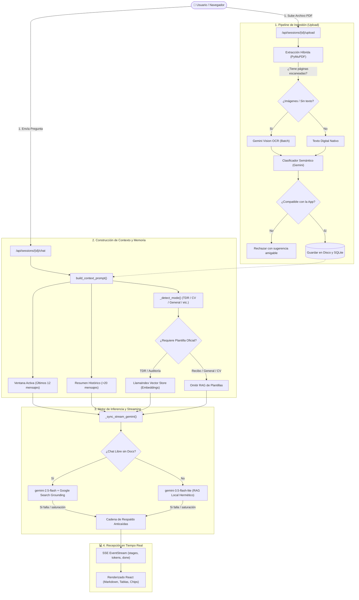
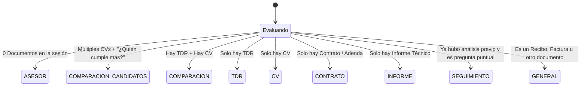

#  Arquitectura Interna, Flujos de Datos y Procesos Técnicos

> **Documento Técnico de Referencia**  
> Este documento describe con precisión de ingeniería cómo opera internamente el sistema por debajo: desde que un usuario sube un archivo o envía un mensaje, hasta la extracción OCR, clasificación semántica, gestión de memoria vectorial, selección de modelos de IA y entrega en tiempo real mediante Server-Sent Events (SSE).

---

##  Tabla de Contenidos

1. [Visión General del Pipeline](#1-visión-general-del-pipeline)
2. [Ciclo de Ingestión y Extracción Híbrida (PDF y OCR)](#2-ciclo-de-ingestión-y-extracción-híbrida-pdf-y-ocr)
3. [Clasificación Semántica de Documentos y Filtro de Compatibilidad](#3-clasificación-semántica-de-documentos-y-filtro-de-compatibilidad)
4. [Vector Store y Embeddings vs. Inyección de Contexto Directo](#4-vector-store-y-embeddings-vs-inyección-de-contexto-directo)
5. [Máquina de Estados y Detección de Modo (`_detect_mode`)](#5-máquina-de-estados-y-detección-de-modo-_detect_mode)
6. [Gestión de Memoria y Resumen Incremental (Ventana 12 / Resumen 20)](#6-gestión-de-memoria-y-resumen-incremental-ventana-12--resumen-20)
7. [Motor de Inferencia, Selección de Modelos y Cadena de Respaldo (Fallback)](#7-motor-de-inferencia-selección-de-modelos-y-cadena-de-respaldo-fallback)
8. [Conexión a Internet (Google Search Grounding) vs. Modo RAG Hermético](#8-conexión-a-internet-google-search-grounding-vs-modo-rag-hermético)
9. [Protocolo de Streaming SSE (Server-Sent Events) en Tiempo Real](#9-protocolo-de-streaming-sse-server-sent-events-en-tiempo-real)
10. [Seguridad, Control de Acceso (RBAC) y Túnel Cloudflare](#10-seguridad-control-de-acceso-rbac-y-túnel-cloudflare)

---

## 1. Visión General del Pipeline

El siguiente diagrama ilustra el ciclo de vida completo de una interacción en el sistema:



---

## 2. Ciclo de Ingestión y Extracción Híbrida (PDF y OCR)

El servicio reside en [`app/services/extraction.py`](file:///d:/Usuario/SOPORTE/llamaindex-proyecto/app/services/extraction.py) y se activa cuando el usuario sube archivos a una sesión:

```
Archivo PDF Subido
       │
       ▼
[ Validaciones Previas ]
  ├─ ¿Firma binaria %PDF válida? (Previene archivos falsificados)
  └─ ¿Tamaño ≤ 15 MB y páginas ≤ 50?
       │
       ▼
[ PyMuPDF (fitz) - Análisis por Página (1 a N) ]
       │
       ├─► Página con texto digital (≥ 100 caracteres):
       │     Se guarda en memoria etiquetada como "--- PÁGINA X ---" (< 10 ms).
       │
       └─► Página escaneada / diploma / imagen (< 100 caracteres):
             │
             ▼
        [ Renderizado a Imagen JPEG (PyMuPDF Pixmap) + Número de Página Real ]
             │
             ▼
        [ perform_ocr_with_gemini() en Bloques Paralelos ]
        • Agrupa en bloques de 12 imágenes (OCR_BATCH_SIZE = 12).
        • Ejecuta hasta 2 bloques en paralelo simultáneamente (OCR_MAX_PARALLEL_BATCHES = 2).
        • Cada imagen viaja precedida por "[IMAGEN DE LA PÁGINA X]" para que
          Gemini devuelva cada certificado con su encabezado exacto "--- PÁGINA X ---".
             │
             ▼
        [ _assign_ocr_pages_to_map() + Ensamblado Ordenado ]
        Reconstruye todo el documento en su orden real de páginas (1..N).
```

### Características Técnicas y Parámetros Ajustables del OCR:
* **Preservación Exacta de Número de Página (`--- PÁGINA X ---`):** Tanto las páginas de texto nativo como las páginas escaneadas conservan su posición y número real dentro del PDF, permitiendo citar con 100% de exactitud en qué página se ubica cada certificado o cláusula.
* **Batch Multimodal Paralelo:** Cada lote de 12 imágenes cuenta como **1 sola petición (Request)** ante la API de Google. Al ejecutar 2 bloques en paralelo, un CV de hasta 24 páginas escaneadas se procesa en una sola tanda simultánea.
* **Resiliencia con `tenacity`:** Si la API devuelve congestión momentánea (`503` o `429`), reintenta automáticamente con retroceso exponencial (`wait_exponential(multiplier=1, min=2, max=10)`).
* **Modelos de OCR configurados:** `gemini-3.5-flash-lite` $\rightarrow$ `gemini-3.1-flash-lite` $\rightarrow$ `gemini-2.5-flash` $\rightarrow$ `gemini-2.5-flash-lite`.

### Tabla de Parámetros de Extracción y OCR (Configurables en `.env` o `extraction.py`):

| Variable | Valor Actual (Free Tier) | Valor Sugerido (API de Pago) | Descripción Técnica |
| :--- | :---: | :---: | :--- |
| **`MIN_CHARS_PER_PAGE`** | **`100`** | **`100`** | Mínimo de caracteres digitales para considerar una página como texto nativo y no enviarla al OCR. |
| **`OCR_BATCH_SIZE`** | **`12`** | **`6` a `8`** | Cantidad de páginas escaneadas enviadas dentro de una misma petición a Gemini Vision. |
| **`OCR_MAX_PARALLEL_BATCHES`** | **`2`** | **`4` a `6`** | Cantidad de bloques de OCR que se procesan en paralelo al mismo tiempo. |
| **`OCR_BATCH_PAUSE_SEC`** | **`2.0`** | **`0`** | Segundos de pausa preventiva únicamente cuando hay una segunda tanda de bloques (> 24 págs. escaneadas). |

---

## 3. Clasificación Semántica de Documentos y Filtro de Compatibilidad

Una vez obtenido el texto completo, el servicio [`app/services/classifier.py`](file:///d:/Usuario/SOPORTE/llamaindex-proyecto/app/services/classifier.py) realiza una inspección preliminar de los primeros 3,000 caracteres del documento:

### 1. Extracción de Metadatos
Se solicita a Gemini una respuesta en formato JSON puro:
```json
{
  "type": "TDR" | "CV" | "CONTRATO" | "ADENDA" | "INFORME" | "RECIBO" | "FACTURA" | "CERTIFICADO" | "DESCONOCIDO",
  "description": "Breve resumen en una línea",
  "confidence": "alta" | "media" | "baja"
}
```

### 2. Filtro de Compatibilidad (`is_compatible`)
Cada módulo del sistema tiene un nivel de restricción según su propósito:

| Módulo / App | Tipos Aceptados | Comportamiento si se sube un Recibo o Factura |
| :--- | :--- | :--- |
| **Auditoría TDR vs CV** (`tdr-cv`) | `TDR`, `CV`, `DESCONOCIDO` | **Rechaza el archivo.** Muestra un aviso informativo indicando que el módulo solo evalúa perfiles frente a TDRs y sugiere usar el Chat Libre. |
| **Auditoría de Contratos** (`contracts`) | `CONTRATO`, `ADENDA` | **Rechaza archivos no contractuales.** |
| **Informes Técnicos** (`reports`) | `INFORME`, `DESCONOCIDO` | **Rechaza comprobantes de pago.** |
| **Chat Libre / Asesor General** (`general`) | **TODOS** (`TDR`, `CV`, `RECIBO`, `FACTURA`, `CONTRATO`, etc.) | **Acepta el archivo.** No lo compara con TDR; lo analiza como documento individual en modo `CONSULTA_GENERAL`. |

---

## 4. Vector Store y Embeddings vs. Inyección de Contexto Directo

Una decisión arquitectónica fundamental del sistema es cuándo usar vectores matemáticos (Embeddings) y cuándo inyectar el texto completo:

```
┌────────────────────────────────────────────────────────────────────────┐
│                        ESTRATEGIA DUAL DE DATOS                        │
├───────────────────────────────────┬────────────────────────────────────┤
│   A) Plantillas Oficiales RAG     │   B) Documentos de la Sesión       │
│      (TDR-FINALPLANTILLA.pdf)     │      (CVs, TDRs, Recibos de usuario│
├───────────────────────────────────┼────────────────────────────────────┤
│ • Indexado permanente en disco.   │ • NO se fragmenta en vectores.     │
│ • Usa "Gemini Embedding 1"        │ • Se inyecta el texto ÍNTEGRO      │
│   (models/gemini-embedding-001).  │   directamente en el prompt.       │
│ • Búsqueda de fragmentos por      │ • Razón: Gemini Flash Lite tiene   │
│   similitud semántica (Top-K = 2).│   1 millón de tokens de ventana.   │
│ • Solo se consulta en modo TDR o  │ • Beneficio: Cero pérdida de datos,│
│   auditoría cruzada TDR vs CV.    │   cálculos de fechas exactos y     │
│                                   │   cero consumo de cuota Embedding. │
└───────────────────────────────────┴────────────────────────────────────┘
```

> [!TIP]
> **¿Por qué se eliminó la vectorización de los documentos de usuario?**  
> Al fragmentar un CV en trozos (*chunks*) vectoriales de 500 palabras, la fecha de emisión del título profesional solía quedar en un fragmento y la experiencia laboral en otro, provocando que la IA "olvidara" la fecha de corte. Al inyectar el texto completo (gracias al millón de tokens de contexto de Gemini), el modelo analiza el expediente con visión 100% holística y sin cortes.

---

## 5. Máquina de Estados y Detección de Modo (`_detect_mode`)

El servicio [`app/services/context_builder.py`](file:///d:/Usuario/SOPORTE/llamaindex-proyecto/app/services/context_builder.py) actúa como una máquina de estados determinista. Analiza la combinación de:
1. Documentos presentes en la base de datos de la sesión.
2. Contenido del mensaje del usuario y palabras clave de intención.
3. Historial de mensajes previos.



### Comportamiento de cada plantilla del sistema:

* **`_TDR_TEMPLATE`:** Audita coherencia numérica de los pagos (deben sumar 100%), discrepancias letras vs. números (ej. *"veinte (40)"*), cronogramas desfasados respecto a la fecha del servidor y cotejo con las 15 secciones estándar de la plantilla institucional.
* **`_CV_TEMPLATE`:** Genera la Ficha Técnica del Candidato (Formación, Experiencia cronológica, Certificaciones, Puntos destacados).
* **`_COMPARISON_TEMPLATE`:** Matriz de auditoría cruzada:
  1. Identifica la fecha exacta de emisión del título/colegiatura.
  2. Descarta periodos anteriores si el TDR exige experiencia *post-título*.
  3. Realiza la sumatoria estricta mes a mes separando sector público de privado.
  4. Asigna veredicto: `✅ CUMPLE`, `⚠️ CUMPLE PARCIALMENTE` o `❌ NO CUMPLE`.
* **`_GENERAL_TEMPLATE` (Recibos, Facturas, Manuales):**
  * **No activa el RAG de TDRs.**
  * Lee el texto extraído del comprobante o documento.
  * Presenta datos estructurados en tarjetas: Razón social, RUC, fechas, detalle del gasto, desglose de impuestos y totales.
* **`_FOLLOWUP_TEMPLATE`:** Cuando el usuario hace preguntas de seguimiento (*"¿Cuánto tiempo trabajó en el Ministerio?"*), prohíbe reimprimir el reporte completo o las tablas iniciales; responde en 1 o 2 párrafos directos para no saturar el chat.

---

## 6. Gestión de Memoria y Resumen Incremental (Ventana 12 / Resumen 20)

Para evitar la degradación de contexto y el desperdicio de tokens en conversaciones extensas, el sistema implementa una **estrategia de memoria híbrida**:

```
Historial Completo de la Conversación
┌──────────────────────────────────────────────────────────┬─────────────────────────────────┐
│     Mensajes Antiguos (Mensaje 1 al Mensaje N-12)        │ Mensajes Recientes (Últimos 12) │
└──────────────────────────────────────────────────────────┴─────────────────────────────────┘
                             │                                               │
                             ▼                                               ▼
               [ ¿Total de mensajes > 20? ]                         [ Ventana Activa ]
                             │                                  Se envían íntegros palabra por
                             ├─► NO: Se envían normales.        palabra para fluidez total.
                             │
                             └─► SÍ:
                                  │
                                  ▼
                [ Tarea Asíncrona en Background ]
                update_history_summary_background()
                Gemini condensa los mensajes viejos en
                un único párrafo consolidado.
                                  │
                                  ▼
                Guardado en DB: session.history_summary
                Se inyecta al inicio del prompt como:
                [RESUMEN DE HISTORIAL ANTIGUO]: ...
```

### Ventajas de este diseño:
1. **Latencia constante:** La conversación no se vuelve lenta al llegar a 50 o 100 mensajes.
2. **Cero pérdida de contexto:** Las decisiones tomadas en los primeros mensajes quedan registradas en el resumen ejecutivo.
3. **Ahorro masivo de cuota:** Evita reenviar miles de tokens redundantes en cada turno de chat.

---

## 7. Motor de Inferencia, Selección de Modelos y Cadena de Respaldo (Fallback)

El servicio [`app/services/streaming.py`](file:///d:/Usuario/SOPORTE/llamaindex-proyecto/app/services/streaming.py) gestiona la comunicación con la API de Google Gemini mediante una **cadena jerárquica de tolerancia a fallos**:

```
Petición de Chat
       │
       ▼
[ Modelo Primario ]
  ├─ Chat Libre sin archivos ──────────► gemini-2.5-flash (con Google Search)
  └─ Chat con archivos o Apps ─────────► gemini-3.5-flash-lite (500 peticiones/día)
       │
       ▼ (¿Ocurre error 429 cuota, 503 saturación o 404 modelo?)
[ Respaldo Nivel 1 ]
  └─► gemini-3.1-flash-lite (500 peticiones/día de cuota independiente)
       │
       ▼ (¿Persiste saturación?)
[ Respaldo Nivel 2 ]
  └─► gemini-2.5-flash (20 peticiones/día)
       │
       ▼ (¿Persiste saturación?)
[ Respaldo Nivel 3 ]
  └─► gemini-2.5-flash-lite (20 peticiones/día)
       │
       ▼ (Si se agotaron todas las cuotas de Google)
[ Mensaje Amigable al Usuario ]
  └─► "Límite de solicitudes alcanzado. Por favor espera unos segundos."
```

### Tabla de Cuotas y Asignación de Recursos:

| Modelo | Cuota Diaria (RPD) | Cuota Minuto (RPM) | Rol en el Sistema |
| :--- | :---: | :---: | :--- |
| **`gemini-3.5-flash-lite`** | **500** | **15** | **Motor Principal Titular:** RAG local, análisis documental, OCR en lotes, clasificador y generación de títulos. |
| **`gemini-3.1-flash-lite`** | **500** | **15** | **Respaldo Primario:** Entra automáticamente si el motor titular presenta saturación (503/429). |
| **`gemini-2.5-flash`** | **20** | **5** | **Búsqueda Web:** Activo únicamente para consultas de internet en tiempo real. |
| **`gemini-2.5-flash-lite`** | **20** | **10** | **Respaldo de Emergencia.** |
| **`Gemini Embedding 1`** | **1,000** | **100** | **Vectorización:** Indexado de la plantilla oficial institucional. |

---

## 8. Conexión a Internet (Google Search Grounding) vs. Modo RAG Hermético

El sistema conmuta dinámicamente el acceso a la red según la presencia de archivos:

```python
is_chat_libre = (session.app_type or "general") == "general"
has_no_docs = len(session.documents or []) == 0

# Internet SOLO si es Chat Libre Y NO tiene documentos adjuntos
enable_search = is_chat_libre and has_no_docs
model_to_use = "gemini-2.5-flash" if enable_search else "gemini-3.5-flash-lite"
```

```
                   ┌──────────────────────────────────────────────┐
                   │               ¿HAY DOCUMENTOS?               │
                   └──────────────────────┬───────────────────────┘
                                          │
                    ┌─────────────────────┴─────────────────────┐
                    │                                           │
                 [ NO ]                                      [ SÍ ]
                    │                                           │
                    ▼                                           ▼
         MODO ASESOR NORMATIVO                       MODO RAG HERMÉTICO LOCAL
  • Modelo: gemini-2.5-flash                  • Modelo: gemini-3.5-flash-lite
  • Búsqueda en Google: ACTIVADA              • Búsqueda en Google: DESACTIVADA (Off)
  • Acceso a leyes vigentes, SEACE,           • Aislamiento total: la única fuente de
    noticias de hoy y fecha oficial.            verdad son tus archivos y la plantilla.
  • Guardrails: Rechaza recetas, chistes      • Sin fugas de datos hacia búsquedas
    y tareas escolares.                         externas.
```

---

## 9. Protocolo de Streaming SSE (Server-Sent Events) en Tiempo Real

El sistema no utiliza peticiones HTTP convencionales que esperan la respuesta entera (lo que causaría que el usuario espere 15 segundos con la pantalla congelada). En su lugar, utiliza **Streaming SSE** a través del generador asíncrono en [`app/routers/sessions.py`](file:///d:/Usuario/SOPORTE/llamaindex-proyecto/app/routers/sessions.py):

### Estructura de Eventos SSE emitidos:

1. **Evento de Estado (`stage`):**  
   Indica a la interfaz qué proceso interno se está ejecutando para mostrar animaciones de carga inmediata (< 1 segundo de latencia):
   ```text
   event: stage
   data: {"stage": "generando", "label": "Analizando requisitos del TDR...", "status": "start"}
   ```
2. **Evento de Fragmento de Texto (`token`):**  
   Envía cada palabra o carácter generado por Gemini a medida que se produce:
   ```text
   event: token
   data: {"text": "## 📊 Cuadro "}
   ```
3. **Evento de Finalización (`done`):**  
   Cierra la transmisión, entrega el nuevo título de la conversación generado en segundo plano y registra el ID del mensaje guardado:
   ```text
   event: done
   data: {"session_title": "Auditoría TDR Obras", "message_id": 482}
   ```
4. **Evento de Error Controlado (`error`):**  
   Si ocurre un error recuperable, emite un aviso sin romper la conexión HTTP:
   ```text
   event: error
   data: {"message": "Has alcanzado el límite de cuota. Espera unos segundos."}
   ```

---

## 10. Seguridad, Control de Acceso (RBAC) y Túnel Cloudflare

### Control de Acceso Basado en Roles (RBAC)
El sistema cuenta con 3 niveles de permisos gestionados en [`app/main.py`](file:///d:/Usuario/SOPORTE/llamaindex-proyecto/app/main.py):

* **`admin` (Administrador General):** Acceso total. Ve la lista de todos los usuarios registrados, métricas globales de auditoría de todas las áreas y el panel de administración.
* **`jefe_area` (Jefe de Logística / Abastecimiento):** Acceso a auditorías de su área, tableros de control y supervisión de expedientes.
* **`empleado` (Especialista / Revisor):** Puede crear sesiones, subir archivos y realizar auditorías individuales de sus propios casos.

### Túnel Seguro Cloudflare (`iniciar_tunel.bat`)
Para exponer el servidor local a internet sin abrir puertos en el router de la oficina ni requerir IP pública fija:
* Utiliza el binario [`cloudflared.exe`](file:///d:/Usuario/SOPORTE/llamaindex-proyecto/cloudflared.exe) comunicándose por túnel cifrado hacia la red de borde de Cloudflare.
* Configuración optimizada contra cierres de sesión:
  ```cmd
  cloudflared.exe tunnel --url http://localhost:8000 --protocol http2 --edge-ip-version 4 --no-autoupdate
  ```
* **Protocolo HTTP/2:** Mantiene vivos los canales de streaming SSE evitando que los firewalls corporativos corten las respuestas a mitad de generación.
* **IPv4 Forzado:** Elimina demoras de negociación DNS por IPv6.

---

> 📝 *Documento mantenido y actualizado en conformidad con el código fuente del proyecto.*
